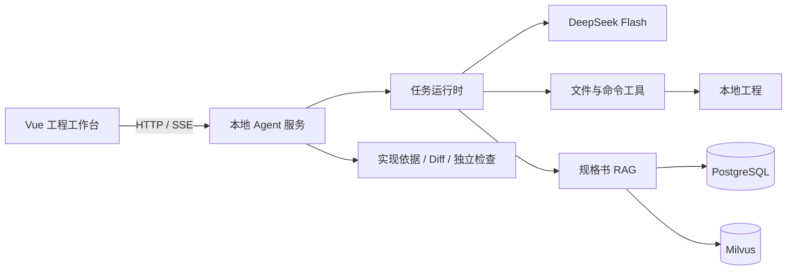

# 嵌入式编程助手

**面向 MCU 模块开发的本地 Agent 工作台。**

将规格书检索、工程文件操作、配置计算和独立检查组织为连续的开发过程。工程师用自然语言描述需求，Agent 在本地工程中完成模块生成、跨模块修改与技术复核，并将实现理由、源码差异、规格依据和检查结果一并交付。

## 典型场景

- **模块开发**：从官方例程和当前工程出发，生成 PWM、定时器等模块，接入初始化与业务入口。
- **工程改造**：同时调整 PWM、USART 等模块参数，保留已有 ADC、定时器和工程设置。
- **芯片改型**：读取已有模块与目标工程，对照规格适配时钟、通道和引脚，保留公开接口与业务行为，并执行目标工程回归检查。
- **规格核对**：按型号、版本查阅寄存器、表格和跨页例程，展开原文并保留页码与片段引用。
- **持续迭代**：在同一会话继续修改需求，或从项目记忆恢复已确认的环境与配置约定。

## 核心能力

| 能力 | 实现 |
|---|---|
| 规格驱动开发 | PDF 结构重建、语义分块、向量与 BM25 混合检索、重排及原文展开 |
| 本地编程 | 读取、写入、精确编辑文件和执行命令；模型按任务选择工具与步骤 |
| 开发技能 | 在聊天中选择模块开发或芯片改型，当前任务加载完整指导；普通对话按需发现技能 |
| 任务运行控制 | 流式事件、并行工具、取消与重试、可选预算、会话持久化与上下文压缩 |
| 项目记忆 | 项目事实、用户偏好与历史会话分层保存，按型号和版本筛选适用事实 |
| 工具式子 Agent | 支持独立或继承上下文、前台或后台委派，以及后续消息与结果收集 |
| 工程交付审阅 | 按实现关联需求、源码位置、规格证据和检查记录，保留完整文件差异 |
| 独立检查 | 宿主提供检查命令；失败输出进入修复过程，交付时对最终文件版本复验 |

## 系统架构



前后端共用一个 Agent 执行链路。任务、会话、记忆及交付文件保存在所选工程的 `.agent-runtime/` 中；浏览器通过 SSE 展示思考摘要、工具活动与结果，工程审阅面板提供实现、改动、依据和检查视图。

技术栈：**Python · FastAPI · Vue 3 · TypeScript · Pinia · PostgreSQL · Milvus · SQLite FTS5**。

## 快速开始

运行环境：Python 3.12+、Node.js 22+、PowerShell 7。规格检索另需 PostgreSQL 与 Docker 中的 Milvus。

```powershell
npm install
cd apps/agent-runtime
py -3.12 -m venv .venv
.venv/Scripts/python.exe -m pip install -e ".[web,dev]"
Copy-Item .env.example .env
```

在 `.env` 中填写本地工程与服务配置：

```dotenv
AGENT_WORKSPACE=/path/to/firmware
OPENAI_BASE_URL=https://api.deepseek.com
OPENAI_API_KEY=your-key
OPENAI_MODEL=deepseek-flash
OPENAI_THINKING=enabled
OPENAI_REASONING_EFFORT=high
AGENT_CONTEXT_WINDOW=1000000
RAG_API_URL=http://127.0.0.1:8000/api/rag
RAG_API_KEY=your-rag-key
```

按 [RAG 服务说明](apps/rag-api/README.md) 准备规格库并启动服务，再回到仓库根目录：

```powershell
npm run dev
```

打开 `http://127.0.0.1:5174`。也可 `npm run build` 后执行 `npm start`，由本地服务在 `http://127.0.0.1:8081` 提供界面。

## 效果与验证

| 日期与场景 | 结果 |
|---|---|
| 2026-10-19，冻结题库 v2.3.1 的 20 道预留题，指定型号与版本 | Top-5 全必要证据命中 19/20；不指定范围的独立口径为 11/17 |
| 2026-10-23，M9P6362 PWM 与 USART 跨模块改参 | 通过独立主机行为、清单与文件保护检查；Agent 根据失败输出修复，无人工修改交付代码 |
| 2026-10-23，M9P6362 → M9F6820 的 ADC、USART 模块迁移 | 源与目标通过相同接口和行为契约，保留目标工程 TC1；芯片寄存器与引脚配置分别核对 |
| 2026-10-23，Web 新增 ADC 滑动平均并同会话改参 | 窗口 5、窗口 8 两轮最终交付均通过独立主机检查，无人工修改交付代码 |
| 2026-10-23，实现依据审阅 | 源码、规格片段与本轮检查可关联，检查对应的工程版本可核对 |

检索指标衡量证据送达；工程结果衡量固定任务的主机检查。固件最终部署需在目标厂商工具链和板卡上验证。原始运行记录与私有规格资料保存在本地。

## 开发与文档

- [架构设计](docs/architecture.md)：运行时、上下文与记忆、RAG、交付检查。
- [开发与演示](docs/development.md)：测试、固定工程演示、交付评分与离线重评。
- [系统运行监控](docs/observability.md)：服务与资源、任务和模型指标、RAG 入库、告警、日志与调用链。
- [Agent 配置](apps/agent-runtime/README.md) · [RAG 服务](apps/rag-api/README.md) · [Web 工作台](apps/web-next/README.md)

```powershell
npm test
npm run test:e2e
```

本地服务监听回环地址，文件和命令工具沿用当前用户权限。API key、规格库、运行状态及实验输出不随源码分发。

## License

[MIT](LICENSE) · [Third-party notices](apps/agent-runtime/THIRD_PARTY_NOTICES.md)
