# 系统原理

[首页](../README.md) · [运行](development.md) · [监控](observability.md)

## 系统边界

工程文件、命令和会话留在本机。Runtime 通过 HTTP 调用规格检索服务，通过模型接口接收文本和工具调用；Web 与 CLI 共用执行循环。

## 证据怎样进入 Agent

普通检索按型号与版本召回证据，再展开原文。可选规格约束图把芯片依赖、已知配置和源码命名写入关联起来，只补读缺失的依据。

规格约束图的输入、状态与适用范围

启用参数：`--spec-relations <关系文件.json>` 或 `SPEC_RELATIONS_PATH`。[关系文件示例](../apps/agent-runtime/examples/spec-relations.example.json)使用虚构芯片与来源。

| 输入或状态 | 含义 |
|---|---|
| `facts` | 已知配置或模式 |
| `source={path,function}` | 宿主读取所选 C 函数的命名写入，保留文件、行号和语句 |
| `ready` | 所选关系的引文已取全，且无未知条件或展开边界 |
| `configuration_status` | 配置满足、不满足或未知，与证据取全分别判断 |

关系按型号、版本和适用条件展开。未解析的分支、调用、间接写入与未知位保留未知；不猜复位值。图内核查范围与实机验证分别报告。

未加载关系文件时，沿用 `search_spec/read_context`；它们默认返回命中原文与来源，显式 `max_chars` 才截取。重排由配置或调用参数启用，缺失依据由现有 Agent 循环补查。

## 检查反馈与交付

- **开发中**：模型调用检查工具，读取真实诊断后继续修改。
- **交付时**：宿主复验最终文件，保存 diff、依据和检查状态，再结束任务。
- **撤回时**：先核对全部受影响文件；存在后续冲突就整轮拒绝，原验收记录保留。

ADC 序列检查比较源、目标 C 模块的 API 行为，缩减失败序列并保存重放输入。它补充固定检查，有限搜索与主机执行范围单独记录。

运行时和源码入口

| 机制 | 源码 |
|---|---|
| 装配与运行循环 | [cli.py](../apps/agent-runtime/app/cli.py)、[loop.py](../apps/agent-runtime/app/loop.py) |
| C 定义与引用定位 | [source_symbols.py](../apps/agent-runtime/app/source_symbols.py) |
| 规格取证与约束核查 | [rag_tools.py](../apps/agent-runtime/app/rag_tools.py)、[spec_evidence.py](../apps/agent-runtime/app/spec_evidence.py) |
| 独立检查与交付 | [project_verification.py](../apps/agent-runtime/app/project_verification.py)、[delivery.py](../apps/agent-runtime/app/delivery.py)、[undo.py](../apps/agent-runtime/app/undo.py) |
| ADC 反例生成与重放 | [adc_sequences.py](../apps/agent-runtime/evaluation/checks/adc_sequences.py) |

工具按可并行与独占模式调度。会话事件、项目事实和用户偏好分别持久化，历史通过 FTS5 按需检索；压缩保持工具调用与结果配对。

模型瞬时故障有限重试，已输出正文和已执行工具不自动重放。熔断状态在进程内共享，服务重启后的任务续接与运行中透明恢复分别处理。

